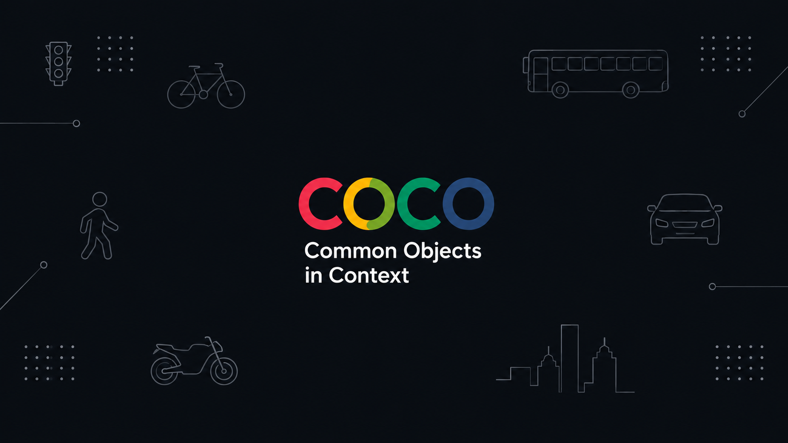

# COCO-2017



Script de pré-processamento do dataset COCO 2017 para formato YOLO, com balanceamento automático de classes.

## Configuração do Ambiente Local

### O que é venv?

`venv` (Virtual Environment) é um isolador de dependências Python. Permite ter versões específicas de bibliotecas sem afetar o sistema global. Essencial para evitar conflitos entre projetos.

### Criar e Ativar o Kernel Local

```bash
# Criar o ambiente (uma única vez)
python3 -m venv venv

# Ativar o ambiente
source venv/bin/activate  # Linux/Mac
venv\Scripts\activate     # Windows

# Instalar dependências
pip install -r requirements.txt
```

Após ativar, o Jupyter usará este kernel local (sem precisar de Colab).

---

## Sobre o COCO 2017

**COCO** (Common Objects in Context) é um dataset de referência para detecção de objetos. Desenvolvido pelo Microsoft Research, contém:

- **330K imagens** com anotações de alta qualidade
- **80 categorias** de objetos (pessoas, carros, animais, etc.)
- **2.5M instâncias** de objetos anotadas com bounding boxes
- **Formato JSON** estruturado com metadados completos

Este script processa o COCO 2017 focando em **5 classes principais**:

```bash
0 → person
1 → bicycle
2 → car
3 → motorcycle
4 → bus
```

O balanceamento automático garante ~3000 imagens por classe, criando um dataset reduzido mas representativo.

---

## Fluxo do Notebook

Assim que terminar de baixar o arquivo COCO de 18 GB:
1. **Célula 0:** Imports globais
2. **Célula 1:** Configurações iniciais
3. **Célula 2:** Funções de suporte
4. **Célula 3:** Mineração e balanceamento
5. **Célula 4:** Extração física
6. **Célula 5:** Relatório tabular
7. **Célula 6:** Split & data.yaml
8. **Célula 7:** Compactação

**Resultado:** Dataset YOLO balanceado e polido, pronto para treinar modelos de detecção.